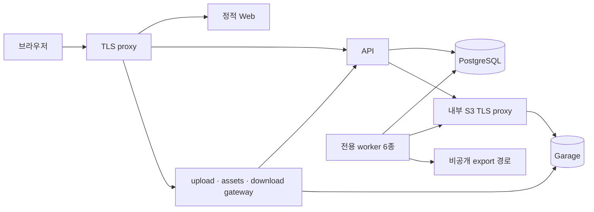

# 배재대학교 게임공학과 졸업작품 전시 시스템

**개요 | [가이드](docs/guide/README.md)**

연도별 졸업작품 전시, Google 로그인, 작품 제출·검토, 이미지·영상·게임·Unity WebGL 처리, 투표·추첨과 자료 내보내기를 제공한다.

| 제공물 | 위치 |
| --- | --- |
| API·worker 공통 이미지 및 기존 entrypoint | [apps/api](apps/api/Dockerfile) |
| 공개 JSON 설정을 읽는 정적 Nginx Web 이미지 | [apps/web](apps/web/Dockerfile) |
| 사람이 편집하는 Quadlet·설정·초기화 SQL | [server/manual](server/manual) |
| 준비·설정·단일 PC·NAS·초기화·운영·검증 절차 | [운영 가이드](docs/guide/README.md) |
| 로컬 개발·Mock·통합 환경 명령 | [개발 가이드](docs/guide/development.md) |
| 업무 경계·migration·release | [architecture](docs/architecture/README.md), [migration policy](docs/database-migration-policy.md), [배포 런북](docs/operations/deployment.md) |

기존 운영은 rootless Podman Quadlet의 API·worker, NAS Docker의 Garage·gateway, GitHub Pages Web으로 구성되어 있다(기존 조사 기준). 이번 작업은 운영 호스트를 변경하지 않는다.

단일 PC 수동 구성은 실행 정의와 격리 검증을 제공한 상태이며, Debian 13·Podman 5.4.2 VM의 전체 기동·재부팅 수용 검사는 남아 있다. 확인 범위는 [검증 기록](docs/guide/verification.md)에 명시한다. 자동 설치기·설정 생성기·통합 배포 CLI는 제공하지 않는다. 운영자는 주소·TLS·Google OAuth 설정·secret·영속 저장소를 직접 준비한다. 실행 PC에는 앱 소스·Node·npm·Prisma 설치가 필요하지 않다.

Web·API·upload·assets·download는 서로 다른 origin을 사용한다. Google 허용 여부는 검증된 token의 `hd`와 설정값의 정확한 일치로 판단한다. 공개 DNS·공인 인증서·실제 Google 로그인은 별도의 운영 확인 항목이다. Web/API가 서로 다른 사이트인 기존 배치의 Safari cookie 제약은 [이슈 #101](https://github.com/pcugame/pcugame.github.io-infra/issues/101)을 참조한다.

이전 README의 기능 설명·WebGL 검증·운영 기록은 [이력](docs/history/repository-overview-20261016.md)에 보존한다.
